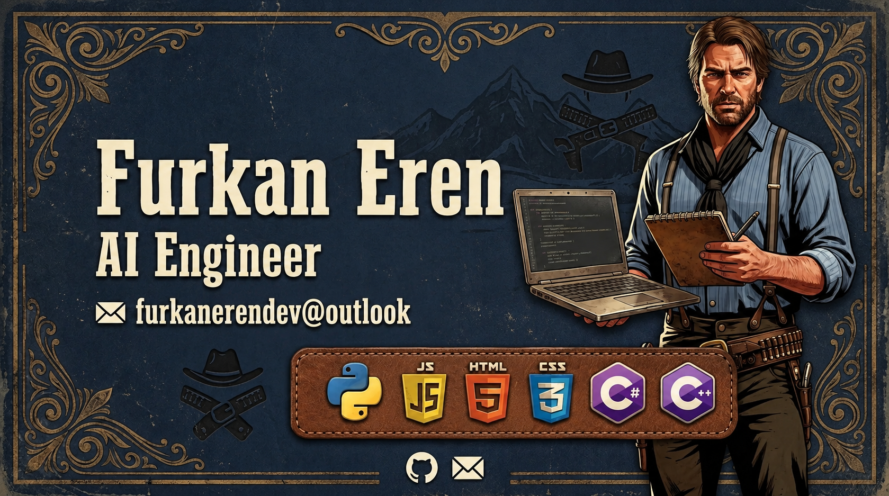

  

<h1 align="center">Hi 👋, I'm Furkan</h1>
<h3 align="center">Passionate AI Engineer & Backend Developer from Turkey</h3>

  

---

### About Me

* 🌱 Currently learning **Python, Artificial Intelligence, HTML5 & CSS3 (Web Development)**
* 💬 Ask me about **Python programming, Web Design basics, and AI concepts**
* 📫 How to reach me: **furkanerendev@outlook.com**
* ⚡ Fun fact: **I code day and night, and I would love to live in the Wild West.**

---

<h3 align="left">Languages and Tools:</h3>

   
   
   
   
   
   
   
   
   
  

---

  

